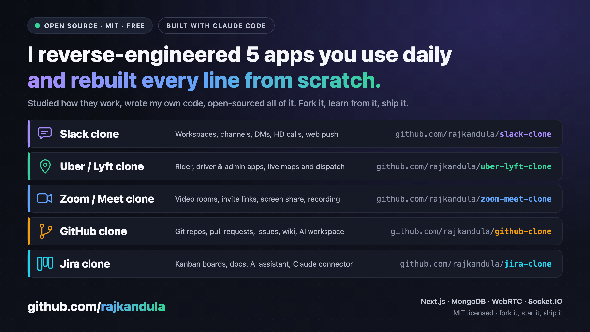

# Hi, I'm Charan Raj Kandula 👋

I build [Harakumo](https://harakumo.com), a cloud platform for shipping apps, and I open-source the apps I build.

## Open-source clones

I studied how the apps I use every day work and rebuilt them from scratch. All MIT licensed: fork them, learn from them, ship them.

| Project | What it is |
|---|---|
| [slack-clone](https://github.com/rajkandula/slack-clone) | Slack: workspaces, channels, DMs, threads and HD calls |
| [uber-lyft-clone](https://github.com/rajkandula/uber-lyft-clone) | Uber / Lyft: rider app, driver app, admin console and realtime dispatch |
| [zoom-meet-clone](https://github.com/rajkandula/zoom-meet-clone) | Zoom / Meet: WebRTC rooms, invite links, chat, screen share and recording |
| [github-clone](https://github.com/rajkandula/github-clone) | GitHub: self-hostable git repos, pull requests, issues, wiki, AI workspace, CLI and MCP |
| [jira-clone](https://github.com/rajkandula/jira-clone) | Jira: Kanban boards, docs, an AI assistant and an MCP connector |
| [medium-clone](https://github.com/rajkandula/medium-clone) | Medium: multi-format editor, AI co-writer, digests and learning paths |
| [kindle-clone](https://github.com/rajkandula/kindle-clone) | Kindle / Apple Books: book store, e-reader and an AI writing studio |

## More open-source apps

| Project | What it is |
|---|---|
| [churchos](https://github.com/rajkandula/churchos) | Church management: people, giving, attendance, groups, events and announcements |
| [skolaos](https://github.com/rajkandula/skolaos) | School management for Indian schools (Nursery–12) |
| [wishly](https://github.com/rajkandula/wishly) | Never miss a birthday: AI-written birthday emails, sent in your name |
| [fruitly](https://github.com/rajkandula/fruitly) | Fresh-fruit e-commerce store |
| [musicbox](https://github.com/rajkandula/musicbox) | Free iOS music player for the songs already on your iPhone |

## 3D and games

- **[splatverse](https://github.com/splatverse)**: Gaussian splatting. [splat-studio](https://github.com/splatverse/splat-studio) turns a video into an interactive 3D scene ([live demo](https://splatverse.github.io/splat-studio/)), and [vertex-3d-studio](https://github.com/splatverse/vertex-3d-studio) builds objects out of dots from a description.
- **[webgl-games](https://github.com/webgl-games)**: games and 3D in the browser: [arcade-3d](https://github.com/webgl-games/arcade-3d), [flight-sim](https://github.com/webgl-games/flight-sim), [opencity](https://github.com/webgl-games/opencity) and [live-3d-cricket](https://github.com/webgl-games/live-3d-cricket).

## Learning and AI

- [dsa-roadmap](https://github.com/rajkandula/dsa-roadmap): data structures and algorithms from first principles, with tested Python and a visualiser.
- [open-model-router](https://github.com/rajkandula/open-model-router): route prompts across open-weight LLMs through one OpenAI-compatible gateway.
- [warehouse-sentinel](https://github.com/rajkandula/warehouse-sentinel): background agents that audit a data warehouse for quality defects.
